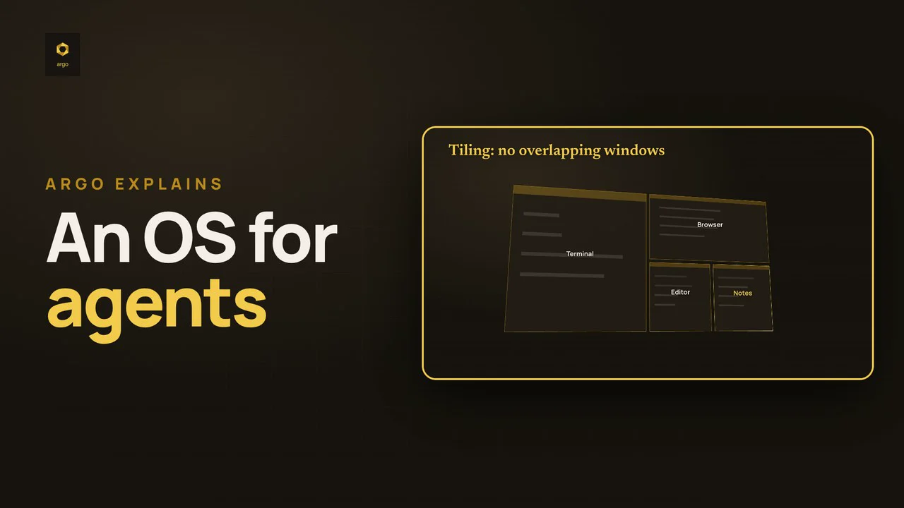
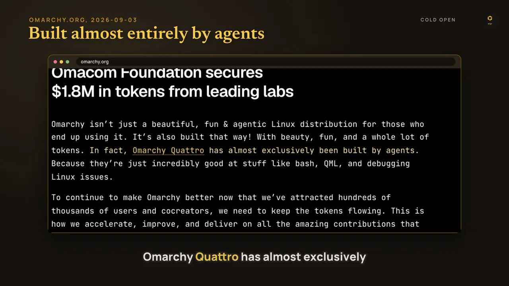
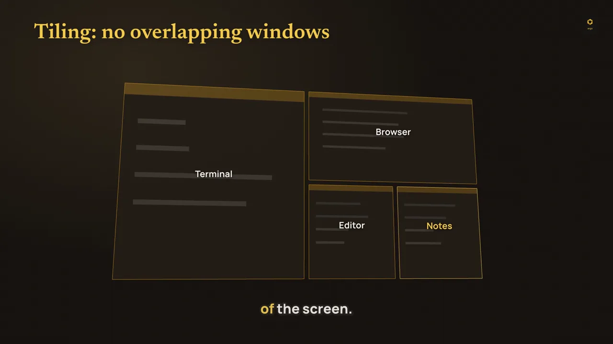
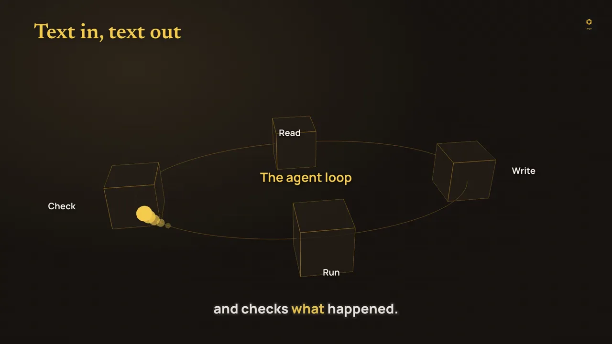
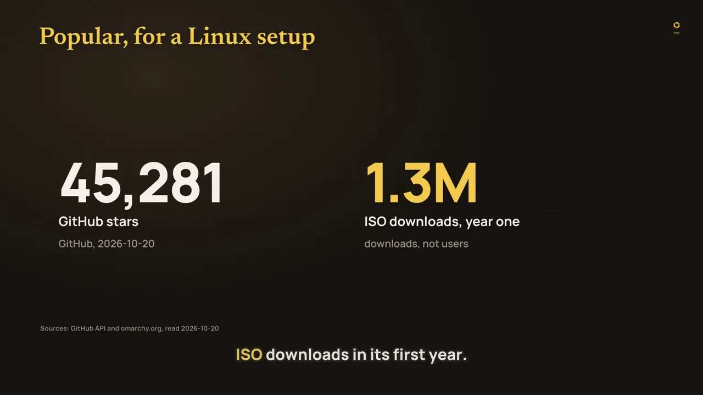
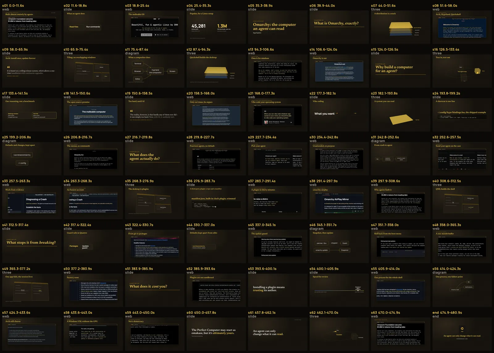
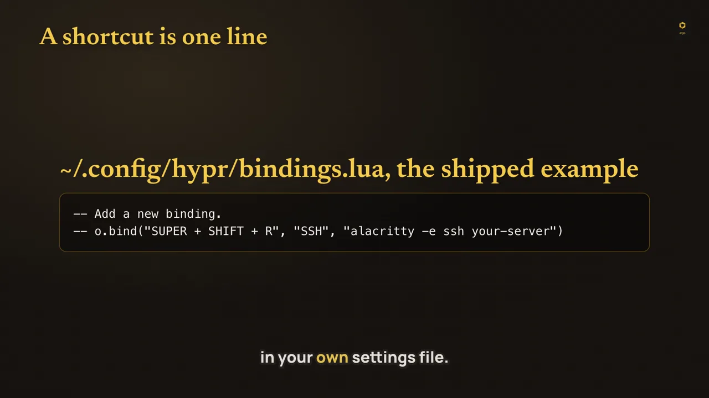

# explainer-episode: the skill we use to make educational TV, now on skillreg

*Konrad Gnat · 2026-10-21 · a skill published on the registry it was built for*



Argo Explains is our educational show: 6 to 10 minute YouTube episodes that explain one system properly, from the primary sources, with the sources on screen. Every episode is made by an agent following one skill, `argo-tv-public`, running on our own render engine. Today a portable version of that skill is on skillreg as `explainer-episode`: the method and the gates, without the renderer. It is signed by our publisher address and rated by the static scanner, so any agent can find it, check it and install it:

```bash
npx -y github:kon-rad/skillreg search explainer video youtube education
npx -y github:kon-rad/skillreg install explainer-episode
```

This post is what the skill does, what it caught when we used it, and what is (and isn't) in the record.

## What it makes

The most recent episode is "Omarchy: the computer an agent can read", about the Linux distribution whose creator wrote that its latest release "has almost exclusively been built by agents". It runs 8:01, 1920x1080, at -14.5 LUFS integrated, in seven chapters, from the cold open through what Omarchy is, why build a computer for an agent, what the agent does, what stops it from breaking and what it costs you, to the idea to keep.

The visual rule is simple and strict: show the real thing first, then the system in motion.



When the narration quotes a page, the page is on screen with that sentence highlighted, wherever the page can be captured (a page behind a bot check becomes a verbatim quote card). When it explains a mechanism, the mechanism moves: windows tiling the screen as each one opens, a token going round an agent's read, write, run, check loop, a diagram that builds node by node as each part is named.





 and reveal in the order the narration names the parts.")

Designed slides carry numbers, and every number on a slide says who measured it and when:



## The loop

The skill is a procedure with two gates. In order:

1. **Research to a PhD standard.** `sources.md` holds every primary source with the verbatim passages the episode may use, then what we infer (labelled as ours), then what we could not source and won't claim.
2. **Script and storyboard.** One shot per sentence, chapters titled as questions, every term defined, every analogy followed by where it breaks.
3. **The fact-check gate.** Every spoken and on-screen claim goes to a separate, read-only fact-checker. The gate opens only on a report with zero incorrect and zero unresolved rows, and it stamps a hash of the exact words. Edit one headline afterwards and the gate closes again.
4. **The critique panel.** Five critics (cut, design, truth, clarity, viewer) score a contact sheet of real frames on nine rubric rows. The editor answers every note in writing, accept or reject with a reason. Two rounds always run.
5. **Render, watch, package.** Spell gate, render, frames pulled at a dozen points and looked at, then an upload-ready YouTube package: title, description with chapters and every source URL, tags, thumbnail, SRT.



## What the gate caught

This is the part that justifies the skill. We had made an earlier Omarchy episode in our old news-desk format. Re-researching it from primary sources for the remake found claims in it that the sources don't support or that had gone stale: the repository had moved; the creator's title was imprecise (co-founder, where his bio says co-owner and CTO); Steam, RetroArch, Proton and a Windows VM are installed from a menu, not preinstalled; Kdenlive and OBS have already been dropped on the development branch; a community testimonial was retold as something it never says; and an install-time figure has no independent source.

Then the new script went through the gate. Round 1 of the fact-check returned 6 incorrect and 5 unresolved claims out of 64. It took seven rounds to finish at 65 of 65 verified (the count grew as lines were split, and the last round re-checked the text after the critique). A sample of what drafts and revisions got wrong:

| Draft said | The source said | Shipped |
|---|---|---|
| Windows don't overlap | The window manager also has floating windows | "By default, tiled windows don't overlap" |
| A config card with a working keybinding | The shipped line is commented out | The shipped lines, comments and all |
| A quote card with "..." | Nothing was cut | The exact words |
| A causal "that is why" | No source makes that link | Two plain sentences |
| "Launcher" labelled as a plugin | The plugin is the Omarchy menu | The source's name |



The critique panel then sent the cut back once (round 1 overall scores 7, 8, 9, 9, 9) and passed it in round 2 (8, 8, 10, 9, 9), for USD 1.08 across both rounds. Some of its suggestions were rejected because they would have added a claim no source makes; the skill requires a written reason every time, and the constitution decides.

## What is in the record, and what isn't

skillreg records are text and capped at 96 KiB, so the record carries the part that travels: the method and the gates. Nine files, 77,101 bytes:

| File | What |
|---|---|
| `SKILL.md` | The loop and the rules that are never traded away |
| `references/constitution.md` | Truth, clarity, depth, honesty about uncertainty, respect, show don't decorate, credit; voice, structure, visual order, layout, captions, sound; the mistakes table above |
| `references/fact-check.md` | The research pack format, the checker's brief, the verdict table, the gate |
| `references/critique-panel.md` | The five briefs, the rubric, the prompt, how to answer notes |
| `references/storyboard.md` | The `storyboard.json` schema: visual kinds, slide styles, scene presets |
| `references/render.md` | The render contract and pipeline for any engine, and how to check the output |
| `references/youtube.md` | The upload package rules |
| `scripts/episode.py` | Standard-library Python: scaffold, lint, claims extraction, the gate, karaoke ASS and SRT captions, the YouTube package |
| `examples/storyboard-example.json` | Thirteen real shots from the Omarchy episode |

Our renderer is not in it. It is about 300 KB of Python and three.js tied to our own render machine, which is three times the record cap and not useful to anyone else as it stands. `references/render.md` describes the contract instead: what timing file, captions, loudness and frames the render must produce, and the stack we use (a local Kokoro voice, faster-whisper word timing, headless Chrome, ffmpeg with libass). The script was tested against the real episode: it rebuilt the same 299 caption groups and the same chapter timestamps.

## Check it yourself

| | |
|---|---|
| Name | `explainer-episode@0xe4daa45be002c1d565fbf8e6a4eade49fdcc4a7a` |
| Version | 1.0.1, 9 files, sha `0x6a4972dcebe40564dc82624b59ebb52e690740e66cf4697708f00af6d7dbff28` |
| Entity key | `0xa6987fc6bf393619385a1f3dd7e1379d55d505908d5a61e96a3de4afab69db8f` |
| Publish tx | [`0xd7e374f1...2e35802b`](https://tiramisu.explorer.arkiv.network/tx/0xd7e374f1b3b24d3d02330b3f431a5c73a8a97be9d4c5170a376ad6542e35802b) |
| Rating tx | [`0x0b5715f1...dda1fcb70`](https://tiramisu.explorer.arkiv.network/tx/0x0b5715f15867feebb98549e2ba47f8d0459cab650b73505e8e82186dda1fcb70), static scanner, clean (info-level URL notes only) |
| Network | Arkiv Tiramisu testnet; the record expires in 90 days unless someone extends it |
| Earlier version | 1.0.0 (key `0xad49fa73...ba02e9f1`) said "65" where round 1 checked 64 claims; our own fact-check of this post caught it, so 1.0.1 replaces it and `install explainer-episode` picks the latest |

Installed into an empty folder on 2026-10-21: verdict PASS, every hash matched, and the files were byte-identical to the [source in the repo](https://github.com/kon-rad/skillreg/tree/main/skills/explainer-episode). Open it in the [web registry](https://kon-rad.github.io/skillreg/registry.html?q=explainer-episode) to read every file before installing anything.

If you make an episode with it and the gate catches something we should add to the mistakes table, tell us. That table is the most useful part of the skill, and it gets better each time someone is wrong in a new way.
